# Singularity Android Layer Architecture (`app/`)

The `app/` module serves as the Native Host Shell for the **Singularity for Android environment (Android ARM64, Bionic + Glibc userspace, targetSdk 28 / minSdk 24)**. 

The host is responsible for launching and supervising the Go-based `language_server` core, providing a secure Chromium WebView-based UI container, hosting a local HTTP System Gateway Server, and integrating directly with the Android platform (notifications, power management, clipboard, storage, and Shizuku/rish).

---

## 1. Overall Component Architecture

```mermaid
graph TD
    subgraph UI_Layer ["Presentation Layer (UI Layer)"]
        LDA["LauncherDarkActivity / LauncherLightActivity"] --> MA["MainActivity"]
        MA --> SC["SplashController (SplashLoadingHtml / Fast Skeleton)"]
        MA --> WVH["WebViewHost (Chromium WebView)"]
        WVH --> AWVC["AgyWebViewClient (OAuth & Asset Interceptor)"]
        WVH --> AWCC["AgyWebChromeClient (Console, Files, Popups)"]
        WVH --> LAS["LocalAssetServer (In-process serving of files/web/)"]
        WVH --> AHI["AppHtmlInjector (Injection of __APP_CONFIG__ and tokens)"]
    end

    subgraph Bridge_Layer ["Bridge & Security"]
        MA --> AB["AndroidBridge (JavascriptInterface 'Android')"]
        AB --> UB["UiBridge (onUiReady, fatal errors, desktop mode)"]
        AB --> TB["ThemeBridge (Theme Synchronization)"]
        AB --> EB["EngineBridge (Engine status & parameters)"]
        AB --> ECJ["EngineConfigJson (Configuration serialization)"]
    end

    subgraph Core_Layer ["Background Services & Supervision (Core Layer)"]
        CSS["CoreServerService (Foreground Service + WakeLock)"]
        CSS --> CPS["CoreProcessSupervisor (Core lifecycle management)"]
        CPS --> CL["CoreLauncher (Phase 1 installation & process spawning)"]
        CPS --> CRP["CoreReadyProbe (Probing https://127.0.0.1:port)"]
        CPS --> OUW["OpenUrlWatcher (Intercepting OAuth/URLs from stdout stream)"]
        CPS --> LS["language_server process (Glibc / ARM64)"]
        CSS --> AGD["agy-daemon background daemon (CLI Task Engine)"]
    end

    subgraph Gateway_Layer ["System Gateway Layer"]
        CSS --> SGS["SystemGatewayServer (HTTP Server on 127.0.0.1:45161)"]
        SGS --> GD["GatewayDispatcher"]
        GD --> NH["NotificationHandler (Task and alert channels)"]
        GD --> BH["BrowserHandler (System browser launching)"]
        GD --> PH["PowerHandler (Partial WakeLock management)"]
        GD --> CH["ClipboardHandler (System clipboard read/write)"]
        GD --> DH["DeviceHandler (Battery, network, haptics, toasts)"]
        GD --> EH["ExecHandler (Local command execution & rish)"]
    end

    subgraph Platform_Layer ["Android Integration"]
        AFP["AppFileProvider (${applicationId}.fileprovider)"]
        DCH["DocumentsContractHelper (SAF to /storage/... resolution)"]
        SHB["ShizukuBridge / RishExecutor (ADB Shell uid=2000)"]
        LIS["LauncherIconSwitcher (Dynamic launcher icon switching)"]
    end

    WVH -.->|JS Call| AB
    LS -.->|Stdout Stream| OUW
    AGD -.->|JSON over HTTP| SGS
    NH -.->|Android Notifications| Platform_Layer
    EH -.->|Elevated Shell| SHB
```

---

## 2. Key Subsystems

### 2.1. Background Services and Core Management (`dev.singularity.antigravity.core`)

The system core (`language_server`) is compiled for Linux/Glibc and executed in the Android environment via a custom loader (`libloader.so`) with instruction-level LSE emulation (`liblse_compat.so`).

- **`CoreServerService`**: 
  - Runs as a `ForegroundService` with the `dataSync` service type and a persistent tray icon (`ForegroundNotification`).
  - Holds a CPU WakeLock (`WakeLockHolder`) with the `PARTIAL_WAKE_LOCK` flag, ensuring uninterrupted agent execution when the screen is turned off.
  - Manages the lifecycle of the core supervisor, HTTP Gateway, and the `agy-daemon` background task engine.
- **`CoreLauncher`**:
  - Orchestrates Phase 1 setup (unpacking and validating the core) and native process execution.
  - Incorporates `killOrphanCoreProcesses()`: scans `/proc` and forcefully terminates (`SIGKILL`) any lingering orphan `language_server` processes from previous sessions prior to startup, eliminating `EADDRINUSE` (`listen: address already in use`) errors on fixed loopback ports (45167/45168 in Singularity, 45157/45158 upstream).
- **`CoreProcessSupervisor`**:
  - Runs the core in a dedicated worker thread (`CoreServerThread`).
  - Continuously streams the multiplexed stdout/stderr output to `files/logs/core.log` and an in-memory circular buffer (`LogRingBuffer`).
  - Implements an automated self-healing restart policy (`CoreRestartPolicy`): exponential backoff upon unexpected termination (up to 3 restart attempts). If the core runs stably for more than 60 seconds (`SUSTAINED_READY_MS`), the failure counter resets.
  - On fatal errors, records detailed stack traces in `CrashRecorder`.
- **`CoreReadyProbe`**:
  - Polls the local HTTPS port for readiness with a timeout of up to 60 seconds (`READY_TIMEOUT_MS = 60000`) to guarantee stable cold starts on baseline ARMv8.0-A CPUs (Snapdragon 660, etc.).
  - Enforces cryptographic Certificate Pinning using the SHA-256 digest of the `@raw/agy_core_cert` certificate.
- **`OpenUrlWatcher`**:
  - Solves the Google OAuth authorization interception challenge (Google blocks authorization within embedded WebViews).
  - Inspects `language_server` output lines in real time, detecting markers such as `AGY_OPEN_URL=`, `ANTIGRAVITY_OPEN_URL:`, and `accounts.google.com` links.
  - Redirects the user to the default external system browser via `CustomTabLauncher`.
  - Also listens for the protected broadcast `dev.singularity.antigravity.ACTION_OPEN_URL`.

### 2.2. WebView, UI, and Application Loading (`dev.singularity.antigravity.ui`)

- **Two-Phase Startup Flow (Splash & Ready Flow)**:
  1. `MainActivity` launches with a lightweight loading overlay (`SplashLoadingHtml`) without blocking during the three-dots animation.
  2. In parallel, `CoreServerService` extracts the core and awaits local HTTPS port readiness (via `CoreReadyProbe`).
  3. Once the port responds, `WebViewHost.loadApp()` injects the HTML payload and configuration.
  4. The splash screen is dismissed only upon receiving the initial JavaScript render signal (`window.Android.onUiReady()`), eliminating white screen flickers.
- **`LocalAssetServer`**:
  - Intercepts `shouldInterceptRequest` calls in `AgyWebViewClient` for the Same-Origin address `https://127.0.0.1:<port>/*`.
  - Serves static assets (`files/web/*`) directly from the in-memory local application cache, offloading static traffic from the Go core server. RPC calls and WebSockets (`/exa.*`, `/jetski.*`, streaming) pass through transparently to the core.
- **`AppHtmlInjector`**:
  - Injects a strict Content-Security-Policy (CSP) directive into the `<head>` of the web bundle.
  - Initializes global objects `window.__APP_CONFIG__`, `window.__AG_ENDPOINTS__`, `window.__AG_CSRF__`, and a single-use cryptographic token `blobBridgeToken`.
- **File Picker & Downloads (`FileDownloader`)**:
  - Handles regular file downloads and Base64 Blobs (`saveBlob`).
  - Supports file and directory selection via the Storage Access Framework (SAF) and persists folder permissions (`takePersistableUriPermission`).

### 2.3. System Gateway (`dev.singularity.antigravity.gateway`)

An embedded, high-performance HTTP server (`SystemGatewayServer`) listening strictly on `127.0.0.1:45170` (dev: `45171`, upstream: `45160/45161`, with automatic fallback to port `+2` if occupied). The active port number is persisted to `files/logs/gateway.port`.

The gateway bridges the Linux userspace environment (bash scripts, `agy-notify`, `agy-daemon` CLI tools) with native Android platform APIs:

| Command | Handler | Description |
| :--- | :--- | :--- |
| `notify` | `NotificationHandler` | Posts, updates progress, and cancels Android notifications across `agy_tasks` and `agy_alerts` channels. |
| `open_url` | `BrowserHandler` | Opens external URLs and system documents via `UriDispatcher`. |
| `wakelock` | `PowerHandler` | Acquires and releases named partial WakeLocks for long-running background scripts. |
| `clipboard` / `clipboard_set` | `ClipboardHandler` | Asynchronously reads and writes to the system clipboard on the UI thread. |
| `system_info` | `DeviceHandler` | Gathers telemetry: battery level, charging status, network type, free memory, and available disk space. |
| `vibrate` | `DeviceHandler` | Triggers haptic feedback of a specified duration. |
| `toast` | `DeviceHandler` | Displays native Android toast messages. |
| `exec` | `ExecHandler` | Executes shell commands (`/system/bin/sh` or elevated `rish` via Shizuku) with timeouts and stream capture. |
| `/gateway/status` | `SystemGatewayServer` | Health check endpoint for gateway status. |
| `/gateway/logs` | `SystemGatewayServer` | Retrieves recent lines of the system log from the in-memory ring buffer. |
| `/gateway/commands` | `SystemGatewayServer` | Returns history and execution statuses of dispatched gateway commands. |
| `/gateway/crash` | `SystemGatewayServer` | Diagnostic snapshot of the most recent core process crash. |

### 2.4. Security and JavaScript Bridge (`dev.singularity.antigravity.bridge`)

The `AndroidBridge` class exposes a strictly minimal, isolated interface to the web frontend (`@JavascriptInterface`).

- **Cross-Frame Protection:** Sensitive operations (`onUiReady`, `onUiError`, `saveBlob`) require passing the cryptographic token `blobBridgeToken`, which is known only to the trusted top-level document. Token comparison uses `MessageDigest.isEqual` to prevent timing attacks.
- **Isolation:** Shell execution, arbitrary notification dispatching, and direct Shizuku access are strictly excluded from `AndroidBridge`. All privileged operations are routed through the local `SystemGatewayServer` instead.

### 2.5. Dynamic Icons and Theming (`dev.singularity.antigravity.theme`)

- **Duolingo-Style Launcher Architecture:**
  Rather than relying on `activity-alias`, two separate real Activity classes are declared in the manifest:
  - `LauncherDarkActivity extends MainActivity` (theme `@style/SplashThemeDark`)
  - `LauncherLightActivity extends MainActivity` (theme `@style/SplashThemeLight`)
  This ensures that the Android 12+ (API 31) system Window Splash renders the correct background color and app icon matching the user's selected in-app theme, independent of the system-wide day/night mode.
- **`LauncherIconSwitcher`**:
  Toggles the enabled component state (`setComponentEnabledSetting`) between activities using the `DONT_KILL_APP` flag strictly when the application enters the background (`onStop`), preventing user session termination.

---

## 3. Audit Findings and Recommendations

### 3.1. Memory Leaks
1. **`MainActivity` Leak via `UiBridge` (RESOLVED):** Added `androidBridge.setActivity(null)` in `MainActivity.onDestroy()`. Replaced strong references to `MainActivity` in `UiBridge` and `AndroidBridge` with `WeakReference<MainActivity>`, preventing activity leaks during configuration changes and recreations.
2. **WebView Leak in `PopupWindowHandler` (RESOLVED):** When `window.open` triggers after passing the URL to the external browser via `oauth.openInBrowser()`, `popup.destroy()` is invoked, releasing the native WebView resources of the popup window.
3. **Static Base64 Reference in `FileDownloader`:** The static field `private static DownloadTask pendingTask` holds up to 64 MB of Base64 data while awaiting permission dialog responses. If the user cancels, memory remains allocated.
   - *Recommendation:* Write temporary data to disk rather than retaining strings in memory, or implement an automated task expiration timeout.
4. **`WakeLock` Accumulation in `PowerHandler` (RESOLVED):** Implemented automated cleanup of inactive or released locks (`!lock.isHeld()`) via `cleanupUnheld()`, along with removing locks from `ConcurrentHashMap` during `status` checks and after `acquire`, preventing memory leaks upon lock timeout (`timeout_ms`).
5. **OOM Protection in `SystemGatewayServer` (RESOLVED):** Added an 8192-byte limit to maximum header line lengths in `readHeaderLine`, preventing DoS/OOM attacks caused by unbounded HTTP headers.

### 3.2. Dead Code
The following classes were identified as unused and removed from the codebase:
- `dev.singularity.antigravity.bridge.ShellBridge` (removed)
- `dev.singularity.antigravity.bridge.ExternalUrlBridge` (removed)
- `dev.singularity.antigravity.bridge.NotificationBridge` (removed)
- `dev.singularity.antigravity.install.ChmodRunner` (removed)
- `dev.singularity.antigravity.oauth.AuthReloader` (removed)
- `dev.singularity.antigravity.oauth.AuthTokenPoller` (removed)
- `dev.singularity.antigravity.ui.lifecycle.DeepLinkForwarder` (removed)
- `dev.singularity.antigravity.ui.splash.SplashLoadingHtml` (removed)
- `dev.singularity.antigravity.util.LoopbackHost` (removed)
- `dev.singularity.antigravity.util.PackageInspector` (removed)

### 3.3. Path and IPC Workarounds
- **`ExecHandler` Integration with `rish` (RESOLVED):** Implemented automated binary path resolution in `ExecHandler` (checking `$PREFIX/bin/rish` and `files/runtime/bin/rish`), ensured mandatory passing of `RISH_APPLICATION_ID` (`context.getPackageName()`) for Shizuku authorization, and cleared potentially conflicting `LD_LIBRARY_PATH`.
- **Hardcoded `/storage/emulated/0/` Paths (RESOLVED):** Replaced hardcoded primary user paths in `DocumentsContractHelper` and `LogExporter` with `Environment.getExternalStorageDirectory().getAbsolutePath()`, ensuring correct operation in Work Profiles and multi-user environments (`/storage/emulated/<userId>/`).
- **`AppFileProvider` Security Vulnerability (RESOLVED):** Added canonical path verification (`file.getCanonicalPath()`) in `getFileForUri` against allowed sandbox directories (`filesDir`, `cacheDir`, `dataDir`, `getExternalStorageDirectory()`, `getExternalFilesDir()`), mitigating Path Traversal (`../`) attacks.
