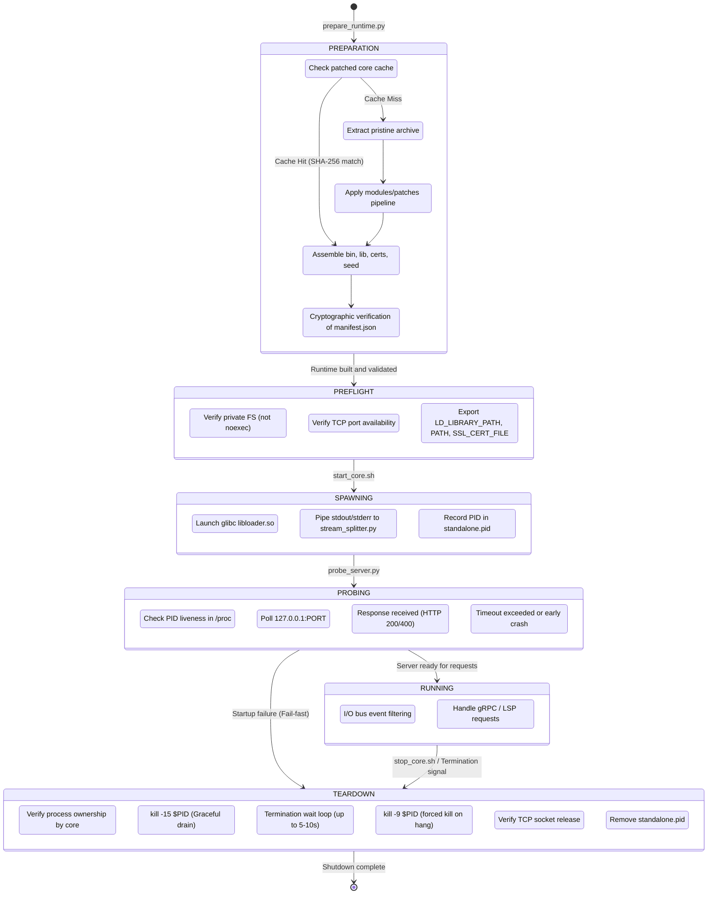

# Runtime Launch and Lifecycle Management Module (`modules/runner`)

> **Architectural Audit and Lifecycle Guide for the Singularity Standalone Core Runtime on Android**

---

## 1. Architecture and File Organization

The `modules/runner` module acts as the orchestrator for building, preparing, launching, health monitoring, and gracefully terminating the Singularity standalone runtime on Android devices (ARM64 / `aarch64` architecture).

```
modules/runner/
├── prepare_runtime.py   # Runtime builder and integrity validator
├── start_core.sh        # Background core startup script with I/O bus integration
├── probe_server.py      # Server liveness/readiness probe monitor
├── stop_core.sh         # Graceful shutdown and resource cleanup script
├── test_e2e.sh          # End-to-end integration test of the full lifecycle
└── README.md            # Lifecycle specification and audit findings
```

### Component Breakdown

| File | Language | Purpose | Key Dependencies |
|---|---|---|---|
| `prepare_runtime.py` | Python 3 | Extracts pristine core, applies patches, assembles `standalone_runtime/`, verifies `manifest.json` | `modules/core`, `modules/patches` |
| `start_core.sh` | Bash | Configures glibc loader, Bionic libraries, launches core and background `stream_splitter.py` pipeline | `modules/io`, `libloader.so`, `liblse_compat.so` |
| `probe_server.py` | Python 3 | Polls local TCP/HTTP port until readiness is confirmed or timeout occurs | `urllib.request`, `socket` |
| `stop_core.sh` | Bash | Stops server process: reads PID, sends `SIGTERM`, waits, escalates to `SIGKILL` | Linux `/proc`, `kill` |
| `test_e2e.sh` | Bash | Automated full-cycle test: build -> start -> probe -> verify logs -> stop | All runner utilities |

---

## 2. Runtime Lifecycle

The Singularity Core process lifecycle consists of 6 sequential phases:



### Detailed Phase Description:

1. **Build Phase (Preparation):**
   - Executed by `prepare_runtime.py`.
   - Checks the cache of the patched core binary (`language_server_patched_aa7d4a1e`). If absent, original core is extracted from `modules/core/pristine/language_server.tar.gz` and passed through `modules/patches/pipeline.py`.
   - Assembles into the target directory (`standalone_runtime`): `bin/` (with `liblanguage_server.so`, `libloader.so`, and browser shims), `lib/` (glibc libraries), `certs/` (`ca-certificates.crt`), `seed/` (configuration templates).
   - Verifies the cryptographic manifest `manifest.json` using SHA-256.

2. **Pre-flight Phase (Pre-flight):**
   - Verifies the filesystem: execution directory must have execute permissions (`noexec` is disallowed).
   - Verifies port conflicts: target port (default `45159`) must be available.

3. **Spawn and Isolation Phase (Spawning):**
   - Executed by `start_core.sh`.
   - Because Android uses Bionic libc (`/system/bin/linker64`) and the core binary is compiled for standard Linux glibc (`aarch64-linux-gnu`), the core is launched via the dynamic loader `libloader.so` (`ld-linux-aarch64.so.1`):
     ```bash
     "$LOADER" --library-path "$RT/lib" [--preload "$LSE_COMPAT"] "$CORE" [arguments...]
     ```
   - Standard output (`stdout`) and standard error (`stderr`) are piped to the `stream_splitter.py` interceptor, which filters logs and dispatches events to the `EventBroker` bus.
   - The process PID is recorded into `standalone.pid`.

4. **Readiness Probe Phase (Probing):**
   - `probe_server.py` periodically polls the server socket on port `45159`.
   - The core listens for TLS on `--https_server_port 45159`. When connected over plain HTTP, the server returns `400 Bad Request`, signaling that the socket is listening and the stack is ready to process requests.

5. **Active Operation Phase (Running):**
   - The server handles Language Server Protocol (LSP) and gRPC requests.
   - Events (URL opening, task changes, error alerts) are handled via the I/O bus.

6. **Teardown Phase (Teardown):**
   - Executed by `stop_core.sh`.
   - Reads the PID from `standalone.pid`.
   - Sends `SIGTERM` (`kill -15`) to the process for orderly termination of background threads, flushing SQLite transactions, and buffer writes.
   - Waits for process termination. If the process does not terminate within the timeout, escalates to `SIGKILL` (`kill -9`).
   - Removes the PID file.

---

## 3. Android Specifics and Limitations

1. **`noexec` Mount on Shared Storage:**
   - External storage (`/storage/emulated/0`, `/sdcard`) is mounted with the `noexec` flag. Attempting to execute binaries or dynamic linkers from `/storage/emulated/0` returns kernel error `EACCES (Permission denied)`.
   - **Requirement:** The runtime must reside strictly within private application storage (`/data/user/0/$APP_ID/files/...`).
2. **Coexistence of Glibc and Bionic:**
   - The system Python 3 interpreter and bash rely on Bionic libraries (`$PREFIX/lib`).
   - The core engine uses glibc libraries from `$RT/lib`.
   - `start_core.sh` isolates environment variables, passing glibc library search paths via the loader's `--library-path` argument, preventing corruption of host binaries.
3. **ARMv8.1-A LSE Atomics Emulation:**
   - On kernels lacking hardware LSE support, the `liblse_compat.so` interceptor is preloaded to install a kernel signal handler for `SIGILL` (4).
4. **Lifecycle Management and LowMemoryKiller (LMK):**
   - Android processes may be evicted by the kernel under memory pressure. Running under a Foreground Service with a Partial WakeLock minimizes this risk.

---

## 4. Audit Findings and Defect Resolutions (Pass 2)

During systematic auditing and refactoring of `modules/runner`, all identified defects were fully resolved:

### Issue 1: PID Masking in Subshell Pipeline (Resolved)
- **File:** `start_core.sh`
- **Before:** `( CMD | python3 ... ) &; SERVER_PID=$!` captured the subshell PID instead of the core binary PID.
- **Implemented:** Migration to a named FIFO channel (`core_stream.fifo`) with job control enabled (`set -m`).
  1. The background interceptor `stream_splitter.py` reads from the FIFO and writes to `core_output.log` (`SPLITTER_PID`).
  2. The core launches directly with output directed into the FIFO (`CORE_PID`), without intermediate subshells.
  3. Real core PID, interceptor PID, and process group PGID are recorded in `standalone.pid`, `standalone.splitter_pid`, `standalone.pgid`, and JSON metadata in `standalone.json`.

### Issue 2: Hardcoded `sleep 1` Prior to `kill -9` (Resolved)
- **File:** `stop_core.sh`
- **Before:** A static `sleep 1` pause followed immediately by an unconditional `kill -9`.
- **Implemented:** Replaced with loop polling via `kill -0 "$PID"` every 0.1s up to a 5.0s timeout (up to 50 iterations).
  - If the core exits gracefully within fractions of a second, shutdown completes immediately without unnecessary delay.
  - An escalating `SIGKILL` (`kill -9`) is only sent if the process hangs beyond 5 seconds.

### Issue 3: PID Recycling Hazard (Resolved)
- **File:** `stop_core.sh`
- **Before:** Blind invocation of `kill -0 "$PID"` without verifying process identity.
- **Implemented:** Inspects `/proc/$PID/cmdline` prior to sending any signal. Signals are dispatched strictly if the process command line contains `language_server`. On mismatch, a warning is issued and the foreign process remains untouched.

### Issue 4: Missing Pre-flight Port Conflict Check (Resolved)
- **File:** `start_core.sh`
- **Before:** Attempting to bind to an occupied port caused hidden failures and masked error state.
- **Implemented:**
  1. Integrated port availability checks via socket connection `/dev/tcp/127.0.0.1/$PORT`.
  2. Added strict protection for reserved ports: ports 45167 and 45168 (45157/45158 upstream) are reserved for the main Singularity IDE runtime; standalone core startup on these ports is rejected with an error.
  3. If port 45159 is occupied, the script first attempts a graceful shutdown of previous instances via `stop_core.sh`, then scans `/proc` for zombie standalone core processes (`antigravity-app-standalone` + `language_server` + `$PORT`) and terminates them.
  4. If the port is not released within 2 seconds, startup terminates with an informative error.

### Issue 5: Cache Validation in `prepare_runtime.py` (Resolved)
- **File:** `prepare_runtime.py`
- **Before:** `TARGET_SHA` was not validated; any corrupted file with a matching name was blindly copied.
- **Implemented:** Added chunked SHA-256 validation of the cached core binary (`ec217e58...`). On hash mismatch, the cache is invalidated, and the core is freshly extracted and patched.

### Issue 6: `probe_server.py` Hanging on Early Server Crash (Resolved)
- **File:** `probe_server.py`
- **Before:** A 40-second blocking HTTP poll occurred even if the core process crashed on the first second.
- **Implemented:** Implemented a fail-fast mechanism: each polling iteration verifies process liveness via `os.kill(target_pid, 0)`. On early termination, `probe_server.py` aborts immediately with exit code 1 and outputs an error.

### Issue 7: Missing Cleanup Trap in `test_e2e.sh` (Resolved)
- **File:** `test_e2e.sh`
- **Before:** Failures at any step left server processes lingering in the system.
- **Implemented:** Added cleanup handler `trap 'bash "$SCRIPT_DIR/stop_core.sh" "$RT"' EXIT INT TERM`, disarmed after successful stop step.

### Issue 8: Dynamic APP_ID Resolution (Resolved)
- **Files:** `start_core.sh`, `stop_core.sh`, `test_e2e.sh`
- **Implemented:** `APP_ID` (`dev.singularity.antigravity` vs `dev.singularity.antigravity.dev`) is resolved dynamically via `AGY_APPLICATION_ID`, regex matching against `$HOME` (`/data/user/0/<app_id>`), or filesystem existence checks.

---

## 5. Supervisor Architecture Model

The current implementation of `modules/runner` relies on a robust model coordinated via FIFO and process groups:

```
[start_core.sh]
       │
       ├──> set -m (activate job control and PGID)
       │       │
       │       ├──> stream_splitter.py (Python) <──stdin── FIFO (/data/user/0/.../core_stream.fifo)
       │       │       └──> core_output.log (with filtering and EventBroker bus)
       │       │
       │       └──> language_server (Glibc via libloader.so) ──stdout/err──> FIFO
       │               └──> Real PID recorded in standalone.pid
       │               └──> PGID recorded in standalone.pgid
       │
       └──> probe_server.py (Fail-Fast monitoring of port 45159 and os.kill(pid, 0))
       │
       └──> stop_core.sh (Verify cmdline, kill -15 -$PGID, polling 0.1s..5s, fallback kill -9)
```

### Key Stability Guarantees:
1. **Process Group Signals (`-$PGID`):** Termination reliably encompasses the core, stream interceptor, and any child workers / sidecars.
2. **Instant Fail-Fast:** `probe_server.py` aborts immediately on core crash without waiting for timeout.
3. **Android System Process Safety:** Protection against PID recycling prevents unintended termination of system services.
4. **Conflict-Free Startup:** Pre-flight validation frees port 45159 from zombie processes prior to initialization.

---

## 6. Testing and Validation Commands

```bash
# 1. Run runtime end-to-end (E2E) integration test:
bash modules/runner/test_e2e.sh

# 2. Run master test suite across all Singularity modules:
bash test_all_modules.sh

# 3. Manual isolated component execution:
# Prepare runtime:
python3 modules/runner/prepare_runtime.py /data/user/0/dev.singularity.antigravity.dev/files/standalone_runtime

# Start core on specified port:
bash modules/runner/start_core.sh /data/user/0/dev.singularity.antigravity.dev/files/standalone_runtime 45159

# Check readiness (with 10-second timeout):
python3 modules/runner/probe_server.py 45159 10

# Graceful stop:
bash modules/runner/stop_core.sh /data/user/0/dev.singularity.antigravity.dev/files/standalone_runtime
```
