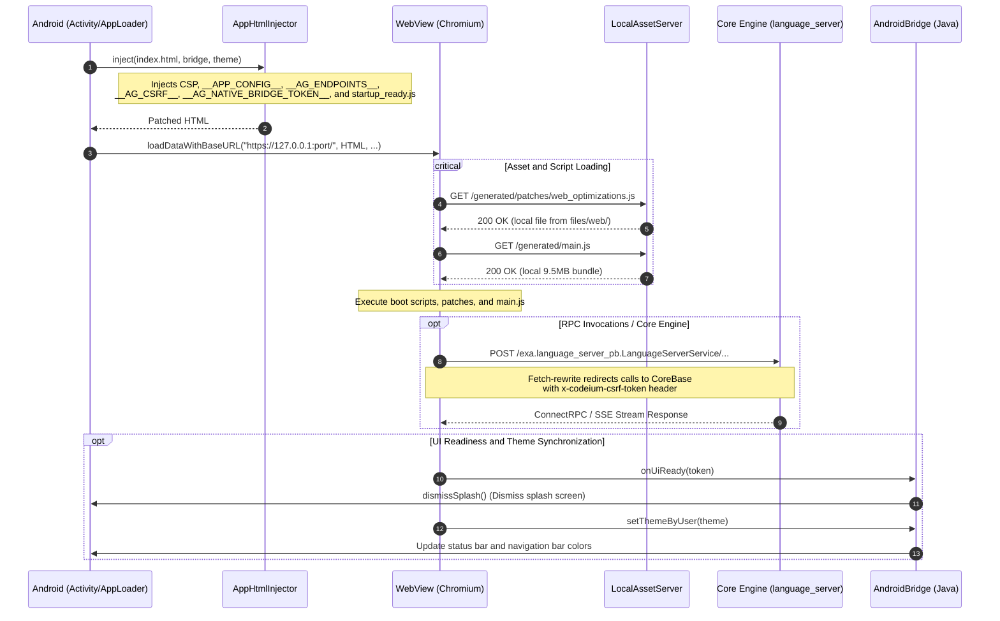

# Antigravity Web Interface: `web/`

> Single-page application (React-based SPA) running within an isolated Android WebView and communicating with the local Go/C++ core (`language_server`) via loopback HTTPS and a native Java bridge (`AndroidBridge`).

---

## 1. Architectural Overview

The Antigravity web layer is a specialized UI frontend packaged within application assets and optimized for Android touchscreen environments (ARM64). Rather than loading via the classic `file:///android_asset/` scheme (which blocks modern browser features and ConnectRPC operations), the interface is mounted in `WebView` via `loadDataWithBaseURL` targeting the trusted loopback server origin `https://127.0.0.1:<port>/`.

### Architecture Interaction Sequence Diagram



---

## 2. Directory and File Structure

```
web/
├── build.sh                      # Bash orchestrator for bundle assembly and patching
├── src.manifest                  # Declarative build manifest for web/generated/**
├── patch_main.py                 # Upstream main.js patcher (Desktop Mode + monochrome Eza)
├── index.html                    # Root HTML template for the application host
├── main.js                       # Upstream obfuscated React UI bundle (~9.9 MB)
├── jetbox.css                    # Styles for custom controls and terminal
├── compiled_tailwind.css         # Compiled base Tailwind CSS bundle
├── prism_bundle.js               # PrismJS syntax highlighting bundle (defer)
├── diff_worker.js                # Web Worker for background string diff computation
├── audio_processor.js            # AudioWorkletProcessor for streaming 16 kHz audio
├── antigravity-icon.png          # Application icon
├── google_signin.svg             # Sign-in button vector asset
├── symbols-icons/                # Local Material Symbols icon cache
├── workers/                      # PDF.js integration modules
│   ├── pdf.min.mjs               # PDF.js core library
│   ├── pdf.worker.mjs            # PDF parsing worker
│   └── pdfjs_loader.mjs          # Bridge between Closure compiler and ESM PDF.js
├── generated/                    # Build artifact directory (generated by build.sh)
│   ├── main.js                   # Patched production application bundle
│   ├── bridge.core.js            # Bridge core, polyfills, and fetch rewriter
│   ├── boot/                     # Early initialization scripts (<head>)
│   │   ├── custom-elements-guard.js
│   │   └── theme-bootstrap.js
│   └── patches/                  # Mobile patches and adapters
│       ├── web_optimizations.js
│       ├── touch_model_menu.js
│       ├── theme_sync.js
│       └── startup_ready.js
├── src/                          # Modular bundle fragment sources
│   ├── boot/                     # Early boot fragments
│   ├── core/                     # Bridge core fragments (namespace, csrf, fetch, ...)
│   └── patches/                  # Feature patch fragments
└── tests/
    └── selftest.sh               # Build verification and source integrity test
```

---

## 3. Bundling Pipeline

The web layer is built by [`build.sh`](build.sh) based on [`src.manifest`](src.manifest). The pipeline is designed to guarantee that the **upstream `main.js` file remains immutable**: all modifications are applied solely to the copy located in `web/generated/main.js`.

### `src.manifest` Syntax
- `bundle iife <path>` — Declares a bundle wrapped in an isolated IIFE `(function(){ ... })();`. If source bundle fragments already contain a top-level closure, `build.sh` automatically skips duplicate wrapping, preventing nested `(function(){(function(){...})()})();`.
- `bundle <path>` — Declares a bundle with direct concatenation without a closure wrapper.
- `src/<path>` — Appends a source fragment to the currently open bundle.
- Lines starting with `#` and `;` are treated as comments.

### Generated Bundles

| Bundle (`web/generated/...`) | Mode | Size | Purpose |
|---|---|---|---|
| **`boot/custom-elements-guard.js`** | IIFE | ~514 B | Prevents crashes caused by duplicate Custom Element registrations in overlay bundles. |
| **`boot/theme-bootstrap.js`** | IIFE | ~1.3 KB | Instantly applies `light`/`dark` before first render, eliminating screen flicker. |
| **`bridge.core.js`** | IIFE | ~12 KB | `window.process` polyfill, configuration, CSRF handling, endpoint discovery, and `fetch` interceptor. |
| **`patches/web_optimizations.js`** | IIFE | ~2.2 KB | Eliminates 300ms tap delay, stabilizes `--agy-vvh` viewport height during IME popup, GPU compositing. |
| **`patches/touch_model_menu.js`** | IIFE | ~6.7 KB | Adapts Base UI model selection hover menu for touch inputs. |
| **`patches/theme_sync.js`** | IIFE | ~4.7 KB | `MutationObserver` on `<html>`/`<body>` classes, forwarding theme changes to native Android. |
| **`patches/startup_ready.js`** | IIFE | ~4.7 KB | Detects first meaningful DOM paint and intercepts JS errors for `AndroidBridge`. |
| **`patches/shield.js`** | IIFE | ~20.1 KB | Quick security policy control button (Security Shield / Turbo mode) in bottom chat panel with EN/PL/RU localization. |
| **`main.js`** | Raw + Patch | ~9.5 MB | Production React UI bundle patched via `patch_main.py`. |

### Verification
After assembly, `build.sh` executes the V8 static syntax analyzer (`node --check`) for each generated file. If Node.js is not present in the environment, the check is skipped with an informational warning.

---

## 4. Main Bundle Patching (`patch_main.py`)

The [`patch_main.py`](patch_main.py) script performs dynamic modification of the compiled and obfuscated `main.js` bundle:

1. **Idempotence**: Prior to patching, checks for the presence of `"Desktop Mode"` or `"ag_desktop_mode"` markers. If found, reapplication is skipped.
2. **Desktop Mode Toggle Injection**:
   - Locates Appearance component hook signatures:
     ```python
     hook_pattern = re.compile(r'(var\s+[A-Za-z0-9_$]+=[A-Za-z0-9_$]+!==3,\s*[A-Za-z0-9_$]+=[A-Za-z0-9_$]+!==2,\s*[A-Za-z0-9_$]+=[A-Za-z0-9_$]+=>\s*[A-Za-z0-9_$]+=>\{.*?\};)')
     ```
   - Injects React hooks `useState` and `useCallback`, binding state with `window.Android.isDesktopMode()` and `localStorage.getItem('ag_desktop_mode')`.
   - Locates the `createElement` call for `{label:"Theme"}` section and injects the Desktop Mode setting control with a toggle (`Switch`) immediately after it.
3. **Settings Export to `QC.Provider`**:
   - Exports the `window.__agySettings` reference for Security Shield integration.
4. **Stream Resume Synchronization (ResumeSync)**:
   - Injects the `refreshTrajectories()` method and global hook `window.__agRefreshTrajectories` into dispatcher `vKa`, automatically reconnecting sockets upon returning to the app.
5. **Unlocking Developer Tab ("Developer-only tools")**:
   - Toggles the base `developerMode` flag in `main.js` (`enabled: !0`, `runtimeEnvironmentOverride: !0`, `featureFlagOverrides: !0`), unlocking the **Feature Environment Override** screen (emulating OS, host, binary, and user type) and **Custom Flags** in the settings menu.
6. **Unlocking Labs Section and Experimental Features**:
   - Activates the **Labs** card in *General* settings with toggles for **Autonomous Mode**, **Inline Actions**, and **Chief of Staff (Concierge Agent)**.
   - Unlocks the agent modes menu (*Modes*) with the autonomous execution toggle in the prompt input bar.
   - Enables the built-in **PDF Viewer**, **File Explorer Tab**, **Split View** (including mobile layout), and **Conversation Forking**.

---

## 5. Native Android Integration (`AndroidBridge`)

The web application runs within WebView, where the `Android` object (as well as alias `window.AndroidBridge`) is exposed via `addJavascriptInterface`.

### Boot-Time Injections (`AppHtmlInjector`)
Before passing HTML markup to the WebView engine, the Java class `AppHtmlInjector` injects into `<head>`:
- **Strict Content Security Policy (CSP)**: Disallows insecure external frames and objects, restricting `worker-src 'self' blob:`.
- **Global Configuration Parameters**:
  - `window.__APP_CONFIG__` — JSON environment parameters (version, platform, workspace paths).
  - `window.__AG_ENDPOINTS__` — Core server endpoints (`core`, `core_http`, `enginePort`).
  - `window.__AG_CSRF__` — Cryptographic CSRF token for `language_server` authentication.
  - `window.__AG_HOST_THEME__` / `window.__AG_RESOLVED_THEME__` — Initial host theme (`dark` / `light` / `system`).
  - `window.__AG_NATIVE_BRIDGE_TOKEN__` — Cryptographic 32-byte single-use token to authorize privileged calls (dismissing splash, saving blobs).
- **Readiness Signal Script**: `<script src="./generated/patches/startup_ready.js"></script>`.

### Bridge Interfaces `window.Android`

| Method | Signature | Purpose |
|---|---|---|
| `onUiReady` | `(token: string) => void` | Invoked by `startup_ready.js` upon first meaningful DOM paint to dismiss the native splash screen. |
| `onUiError` | `(token: string, message: string) => void` | Forwards critical fatal JS errors to native logcat and the error UI. |
| `setThemeByUser`| `(theme: string) => boolean` | Communicates user-selected theme (`light`/`dark`) to update Android system bar colors. |
| `onVisualThemeChanged` | `(theme: string) => void` | Signals an active CSS presentation change. |
| `getTheme` | `() => string` | Returns the device's current system theme. |
| `isDesktopMode` | `() => boolean` | Checks whether wide desktop viewport mode is enabled. |
| `setDesktopMode`| `(enabled: boolean) => void` | Dynamically switches WebView User-Agent and Viewport between mobile and desktop modes. |
| `openDirectoryPicker` | `() => void` | Launches the system directory picker (SAF Document Tree) to open a project. |
| `saveBlob` | `(token, base64, filename, mime) => void` | Securely saves web-generated blobs to the device `Downloads` storage. |

---

## 6. Web Layer Subsystems

### 6.1. Theme Engine
1. **Early Stage (`theme-bootstrap.js`)**: Executes synchronously in `<head>`. Reads `?hostTheme=` or `__AG_HOST_THEME__`. Immediately applies class `dark`/`light` to `document.documentElement` and sets `style.colorScheme`. Eliminates white flash during cold start in dark theme.
2. **Runtime Synchronization (`theme_sync.js`)**: 
   - `MutationObserver` watches `class` attribute changes on `<html>` and `<body>`.
   - `window.addEventListener('storage')` listener tracks theme changes across tabs.
   - `matchMedia('(prefers-color-scheme: dark)')` listener responds to system night mode schedules.
   - `notify()` updates native Android status and navigation bars.

### 6.2. Mobile & Touch Optimizations
- **`web_optimizations.js`**:
  - `touch-action: manipulation` on buttons, links, and inputs eliminates the browser 300ms double-tap delay.
  - `visualViewport.addEventListener('resize')` dynamically recalculates the `--agy-vvh` pixel variable, preventing chat input bouncing when the IME keyboard appears.
  - Selective `transform: translateZ(0)` forces GPU compositing layers strictly on key scroll containers (`chat-container`, `.scrollable`), avoiding VRAM exhaustion and RenderThread hitches on ARM Mali chips.
  - `resume_sync.js`: Intercepts app foreground events (`agy:host-resume`, `visibilitychange`, `focus`) and resynchronizes active ConnectRPC streams (`__agRefreshTrajectories()`), instantly fetching background-generated AI thoughts and steps.
- **`touch_model_menu.js`**:
  - The Antigravity model selection dropdown in Base UI opens reasoning effort submenus (Low / Medium / High) strictly via mouse hover events.
  - On touchscreens, tapping caused immediate selection of the default model without revealing reasoning options.
  - The patch intercepts `pointerdown`/`click` during the capture phase, blocks the event, simulates a synthetic pointer event sequence (`pointerover`, `pointerenter`, `pointermove`), and dispatches `KeyboardEvent('ArrowRight')` at 70ms and 260ms delays, ensuring submenu expansion on touch devices.

### 6.3. Core Transport & Fetch Rewrite
- **`bridge.core.js`**:
  - Polyfills `window.process` (Linux / ARM64 / renderer) with standard `cwd()` and `nextTick()` methods.
  - Overrides `window.fetch`. All requests targeting ConnectRPC markers (`exa.language_server_pb.`, `exa.host_bridge_pb.`, `/exa.`) are rewritten to the target core origin `https://127.0.0.1:<enginePort>`.
  - Automatically injects the CSRF header `x-codeium-csrf-token` and `csrf_token` parameter.
  - Implements retry logic `fetchWithStartupRetry` (up to 30 attempts with 120ms intervals), preventing initial request failures if the frontend loads before core TLS socket binding finishes.

### 6.4. Workers and Audio Processing
- **PDF Pipeline (`workers/`)**: Isolated document handling within `pdf.worker.mjs` without blocking the main UI thread.
- **Diff Calculation (`diff_worker.js`)**: Background string diff calculation (Myers algorithm $O(ND)$ with prefix/suffix trimming) offloaded to a Web Worker.
- **Voice / Audio Processor (`audio_processor.js`)**: Registered as `AudioWorkletProcessor` named `audio-streaming-processor`. Performs streaming microphone downsampling to 16 kHz PCM (`Int16Array`) for multimodal model ingestion.

---

## 7. Audit Findings: Architectural Nuances and Recommendations

During the web layer audit, architectural nuances, bottlenecks, and workarounds were cataloged:

| Issue / Workaround | Location | Risk Description | Recommended Fix |
|---|---|---|---|
| **Missing Web Build Step in APK Pipeline** | `modules/builder/05_stage_assets.py` | `05_stage_assets.py` verified and assembled `env`, but for `web/` simply copied existing `web/generated/`. If a developer edited `web/src/**` without running `web/build.sh` manually, stale bundles shipped into the APK. | **[Fixed]** Added automatic invocation of `bash web/build.sh` prior to asset staging in `05_stage_assets.py`. |
| **Leak of `src.manifest` into Release APK** | `modules/builder/05_stage_assets.py` | `src.manifest` was missing from `web_ignore`, causing the build manifest to be bundled into production APK assets. | **[Fixed]** Added `"src.manifest"` to the `web_ignore` exclusion tuple. |
| **Fragile Regex Patching in `main.js`** | `web/patch_main.py` | The patcher relies on exact obfuscated React variable signatures (`var C=g!==3,D=g!==2...`) and hardcoded fallback component names (`item_comp="v3"`, `switch_comp="dX"`). Upstream bundle updates may cause injection failures or `ReferenceError`. | Implement syntax verification via an AST parser or add strict CI UI regression tests. |
| **Redundant Double IIFE Wrapping** | `web/src.manifest`, `src/boot/theme-bootstrap.js` | Source `theme-bootstrap.js` already contained a closure `(function(){...})()`, while declared in the manifest as `bundle iife`. This generated nested IIFEs. | **[Fixed]** Added `is_already_iife` check in `web/build.sh` to skip wrapping already closed fragments. |
| **Hardcoded `/tmp` Dependency on Android** | `web/build.sh` (line 28) | Invoking `mktemp "${TMPDIR:-/tmp}/..."` failed on Android when `$TMPDIR` was unset, as `/tmp` does not exist on Android. | **[Fixed]** Replaced with portable path `${TMPDIR:-${HOME:-.}/.tmp}` with automatic directory creation. |
| **Hardcoded CSRF Fallback** | `web/src/core/csrf.js` (line 13) | If no token is provided via `__AG_CSRF__` and none exists in the DOM, constant `'agy-standalone-token'` was used. | Generate a random UUID/Hex fallback token at initialization instead of a static constant. |
| **Inconsistent Discovery Port Scheme** | `web/src/core/endpoints.js` (line 50) | Parsing URL parameter `?port=` assigned `ENDPOINTS.core_http = 'http://127.0.0.1:' + port;`, whereas core operates strictly over HTTPS. | Change scheme to `https://127.0.0.1:` to align with TLS transport. |
| **Delay-Based Touch Event Emulation** | `web/src/patches/touch_model_menu/` | Model menu expansion relies on consecutive `setTimeout(..., 70)` and `setTimeout(..., 260)`. Under heavy CPU load, delays may misfire. | Use MutationObserver or focus-change events to confirm submenu opening. |

---

## 8. Verification and Testing

To verify web layer integrity and build stability, execute the self-test suite:

```bash
bash web/tests/selftest.sh
```

The test performs:
1. Creation of an isolated temporary copy of `web/`.
2. SHA-256 checksum capture of upstream `main.js`.
3. Execution of `web/build.sh` and `patch_main.py`.
4. Verification that upstream `main.js` remains unmodified.
5. Verification of all generated artifacts and path validity in `index.html`.
6. Verification that generated bundles contain no redundant double IIFE wrappers.
